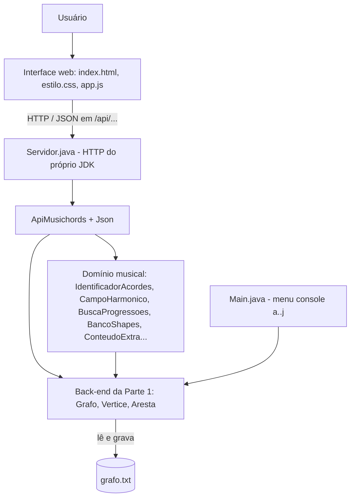
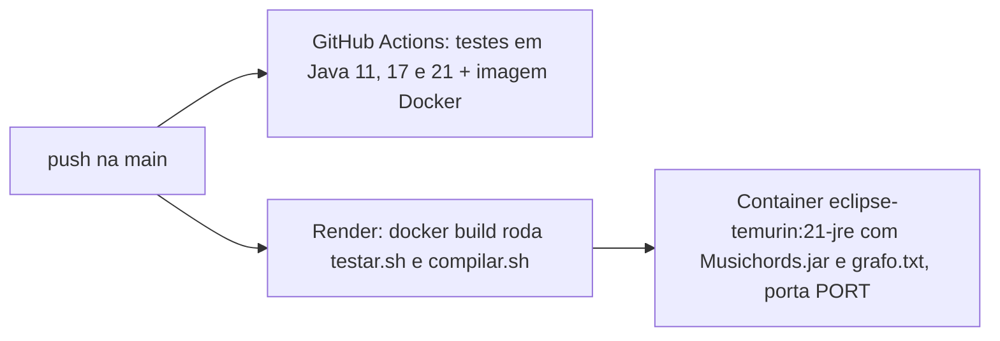

# Musichords

[](https://github.com/lelmegl/Musichords/actions/workflows/testes-backend.yml)

Modelagem de progressões harmônicas para guitarra via grafos de campos harmônicos
(Teoria dos Grafos / Engenharia de Software — Universidade Presbiteriana Mackenzie).

**Integrantes:** Gustavo Kiyoshi Ikeda (10439179) · Pedro Montarroyos de Pinho (10440213) · Felipe Marques Leite Martha (10437877)

## Retomada dos objetivos

Iniciantes de guitarra e violão costumam aprender acordes de forma isolada, memorizando posições dos dedos sem
compreender por que certos acordes soam bem em sequência. As ferramentas mais comuns (ex.: Cifra Club, Chordify)
mostram o shape de cada acorde ou identificam acordes de músicas, mas não sugerem progressões nem medem o esforço
físico de trocar de um acorde para outro.

**Objetivo geral:** desenvolver um aplicativo que, a partir das notas selecionadas pelo usuário no braço da guitarra,
identifique o acorde e sugira progressões harmonicamente válidas e de menor custo físico de execução, utilizando um
grafo direcionado e ponderado de campos harmônicos:

- **vértices** = papel funcional (grau) de um acorde em uma tonalidade;
- **arestas funcionais** = transições permitidas dentro de uma tonalidade (tônica, subdominante, dominante);
- **arestas de pivô (peso 0)** = mesmo acorde físico em tonalidades diferentes;
- **peso** = esforço físico de transição entre os shapes; as progressões saem de uma busca de caminho mínimo.

O projeto se relaciona com a **ODS 4 – Educação de Qualidade** (aproxima a teoria harmônica da prática no instrumento)
e a **ODS 9 – Indústria, Inovação e Infraestrutura** (ferramenta educacional de baixo custo baseada em software).

## Principais funcionalidades alcançadas

- **Braço interativo** de 12 casas, uma nota por corda, com exemplos prontos (RF03).
- **Identificação do acorde**: tríades maiores, menores e diminutas, tétrades com sétima (reduzidas à tríade),
  detecção de inversão e shape de referência (RF04).
- **Mapeamento no grafo**: todos os vértices em que o acorde aparece, com sua função tonal e o campo harmônico (RF01).
- **Progressões sugeridas** de 3 a 6 acordes, ordenadas pelo custo total (soma dos pesos das arestas), com opção de
  modulação por acorde pivô (RF02).
- **Caminho mínimo (Dijkstra)** do acorde tocado até um acorde de destino (RF06).
- **Shapes da progressão** escolhida, acorde a acorde, com o peso de cada transição (RF07).
- **Extras**: músicas de referência, escalas no braço e campo harmônico completo (RF05).
- **Aba do grafo**: opções a..i do menu da Parte 1 (ler, gravar, inserir/remover vértices e arestas, conteúdo do
  arquivo, lista de adjacência, conexidade), Dijkstra entre dois vértices e desenho do grafo no círculo das quintas.
- **Modo console** da Parte 1 (`java -jar Musichords.jar console`).
- **API REST em JSON** documentada, **testes automatizados** no GitHub Actions e **deploy na nuvem** (Docker + Render).

## Como executar
## Engenharia de Software

Único requisito: **Java 11 ou mais novo** (qualquer JDK/JRE; o GitHub Codespaces já vem com Java).
Não há Maven, bibliotecas nem downloads: o projeto já vem com o `Musichords.jar` pronto.

```bash
cd Musichords
java -jar Musichords.jar            # interface no navegador -> http://localhost:8080
```
## Parte 2 Projeto de Grafos
```
cd Musichords
java -jar Musichords.jar console    # menu de texto (Parte 1: a..i, Parte 3: k..o, j encerra)
```

## Parte 3 Projeto de Grafos

Título da aplicação: **MUSICHORDS - Progressões Harmônicas de Menor Esforço via Grafos**.
O menu de texto ganhou cinco opções, todas com o conteúdo da disciplina e implementadas sem bibliotecas de grafos:

| Opção | Técnica | O que mostra no grafo do projeto |
|---|---|---|
| **k)** Progressão de menor esforço | Dijkstra (item 1: solução do problema) | origem e destino por ID ou rótulo (ex.: `G_I` → `C_I`); imprime o caminho, cada troca com seu peso (peso 0 = pivô, mesmo acorde em outra tonalidade) e o custo total — `G_I → C_V → C_I`, custo 5 |
| **l)** Graus e caminho euleriano | grau de entrada/saída/total, teorema de Euler | tabela de graus (mín. 2 em `C_vii`, máx. 14 em `C_I`); 48 vértices de grau ímpar → **não** há caminho euleriano |
| **m)** Hamilton e Caixeiro Viajante | teoremas de Dirac e Ore, ciclo hamiltoniano, vizinho mais próximo com distâncias de Floyd | Dirac e Ore inconclusivos (grau mín. 2 < 42; soma 28 < 84), mas o percurso em profundidade com retorno (backtracking) encontra um ciclo hamiltoniano e o verifica; rota do Caixeiro Viajante a partir de `C_I` com custo 248 |
| **n)** Coloração | coloração por classe (Welsh e Powell) e k-partição | 5 cores na ordem do arquivo e 4 cores ordenando por grau; `C_I C_ii C_V C_vi` (progressão I–vi–ii–V) formam um K4, então χ = 4: o grafo é 4-partido e não é bipartido |
| **o)** Árvore geradora mínima | Kruskal, com o percurso em profundidade para detectar ciclos (conferido com Prim) | 83 arestas, custo 149 (48 pivôs de peso 0 + 35 trocas) |

As opções l, m, n e o tratam o grafo subjacente (sem direção) quando o conceito é de grafo não orientado
(coloração, árvore geradora mínima, grau total); o ciclo hamiltoniano e o Dijkstra respeitam o sentido das arestas.

Os algoritmos seguem o material da disciplina. Os percursos em profundidade (pilha) e em largura (fila) foram escritos
exatamente como nos slides de *Algoritmos de Busca em Grafos* e são usados pelo Kruskal (ciclo), pela conexidade do
grafo subjacente (teste de Euler) e pelo teste de bipartido. O único acréscimo fora dos slides são as podas da busca
do ciclo hamiltoniano, sem as quais a busca não termina em 84 vértices.

Ou use os atalhos: **Windows** → dois cliques em `executar.bat` · **Linux/macOS** → `./executar.sh`.

No computador o navegador abre sozinho. Se não abrir, acesse `http://localhost:8080`.
Para encerrar, pressione `Ctrl+C` no terminal.

### GitHub Codespaces

1. Abra o repositório em um Codespace.
2. No terminal: `java -jar Musichords.jar`
3. O VS Code mostra o aviso "Your application running on port 8080 is available" → **Open in Browser**
   (ou aba **PORTAS** → porta 8080 → ícone do globo). O próprio programa também imprime o endereço.

Com a pasta `.devcontainer/` incluída, o Codespace já inicia o Musichords e abre o navegador sozinho.

### IntelliJ / VS Code

- **IntelliJ**: *File → Open* na pasta `Musichords` e rode a configuração **"Musichords (navegador)"** (ou "console").
- **VS Code**: abra a pasta e rode **"Musichords (navegador)"** em *Run and Debug*.

Depois de editar o código-fonte, rode `compilar.bat` / `./compilar.sh` para gerar o `Musichords.jar` de novo
(precisa do JDK). Os arquivos da interface (`src/web/static`) também são lidos direto da pasta, então mudanças
no HTML/CSS/JS aparecem só recarregando a página quando o programa é executado pela IDE.

## O grafo (`grafo.txt`)

| Item | Valor |
|---|---|
| Categoria | 6 — orientado, com peso nas arestas |
| Vértices | 84 = 12 tonalidades maiores × 7 graus, rótulo `Tonalidade_Grau` (ex.: `G_IV` = acorde C como IV de Sol maior) |
| Arestas funcionais | 240 (20 por tonalidade), transições permitidas pelas funções tonais |
| Arestas de pivô | 144, peso 0, nos dois sentidos, entre vértices do mesmo acorde físico (ex.: `C_I` ↔ `G_IV` ↔ `F_V`) |
| Peso | número de cordas que mudam de posição entre os shapes dos dois acordes (0 a 6) |
| Conexidade | C3 — fortemente conexo |

O teste `DominioTest` confere, aresta por aresta, que cada peso do `grafo.txt` corresponde aos shapes do `BancoShapes`
e que todos os pivôs existem nos dois sentidos.

## Desenho da arquitetura do sistema



**Entrega contínua:**



Resumo do fluxo:

```
navegador (HTML/CSS/JS)  ⇄  Servidor.java (HTTP do próprio JDK)  ⇄  ApiMusichords  ⇄  Grafo / domínio  ⇄  grafo.txt
```

- O `Servidor` usa `com.sun.net.httpserver`, que faz parte do JDK — nenhuma biblioteca externa.
- **Toda informação vem do back-end da Parte 1** (`Grafo`, `Vertice`, `Aresta`) carregado do **`grafo.txt`**:
  - as opções **a) ler, b) gravar, e) remover vértice, f) remover aresta, g) conteúdo, h) lista de adjacência e
    i) conexidade** chamam os próprios métodos do `Grafo`, e a tela mostra exatamente o texto que eles imprimem;
  - os acordes, graus e funções vêm do rótulo `Tonalidade_Grau` de cada vértice (ex.: `G_IV` = grau IV de Sol maior = C);
  - o custo das progressões é a soma dos **pesos das arestas**; as arestas de **peso 0** são os pivôs entre tonalidades;
  - inserir/remover pela aba do grafo altera o grafo em memória e o fluxo passa a usar os novos dados
    (use **b) Gravar** para salvar no `grafo.txt`).
- A interface só apresenta os dados; o navegador não faz nenhum processamento.

## API do backend (endpoints)

Todas as respostas são JSON. Parâmetros vão na URL (GET) ou no corpo como formulário (POST).
Parâmetro ausente ou inválido → **400**; rota inexistente → **404**; erros de regra (ex.: vértice repetido)
voltam com **200** e `{"ok": false, "mensagem": "..."}`.

| Método | Rota | Parâmetros | O que devolve |
|---|---|---|---|
| GET | `/api/estado` | — | arquivo carregado, nº de vértices/arestas e notas do braço da guitarra |
| GET | `/api/grafo` | — | vértices, adjacências e a interpretação musical de cada vértice |
| GET | `/api/identificar` | `casas=-1,3,2,0,1,0` (uma casa por corda, -1 = não tocada) | acorde, tríade, inversão, shape e vértices onde ele aparece |
| GET | `/api/progressoes` | `raiz`, `tipo` (`MAIOR`, `MENOR`...), `tamanho`, `modulacao` | até 10 progressões ordenadas pelo custo |
| GET | `/api/caminho` | `raiz`, `tipo`, `destRaiz`, `destTipo` | caminho mínimo (Dijkstra) entre dois acordes |
| GET | `/api/acordes` | — | acordes distintos presentes no grafo |
| GET | `/api/exemplos` | — | shapes de exemplo para o braço |
| GET | `/api/texto` | `tipo=arquivo` \| `lista` \| `conexidade` | saída das opções g, h e i do menu |
| GET | `/api/dijkstra` | `origem`, `destino` (ID ou rótulo, ex.: `G_I`) | opção k: custo, caminho mínimo e o texto do console |
| GET | `/api/analise` | `tipo=euler` \| `hamilton` \| `coloracao` \| `agm` | opções l..o: texto do console e os dados destacados no desenho (vértices de grau ímpar, ciclo hamiltoniano, classes de cor, arestas da árvore mínima) |
| POST | `/api/operacao` | `op=ler` \| `gravar` \| `inserirVertice` \| `inserirAresta` \| `removerVertice` \| `removerAresta` + `id`, `rotulo`, `origem`, `destino`, `peso`, `caminho` | executa as opções a..f do menu |

Exemplo: `curl "http://localhost:8080/api/caminho?raiz=0&tipo=MAIOR&destRaiz=7&destTipo=MAIOR"`

## Testes automatizados

Os testes ficam em `Musichords/test/` (JUnit 4, sem Maven) e cobrem três camadas (87 testes):

| Classe | O que testa |
|---|---|
| `ApiEndpointsTest` | sobe o **servidor HTTP real** numa porta livre e chama cada endpoint `/api/*`, conferindo status, JSON e os efeitos das operações (inserir/remover/gravar/ler) |
| `GrafoTest` | `Grafo` da Parte 1: inserção, remoção, leitura/gravação do arquivo, conexidade e Dijkstra num grafo calculado à mão |
| `GrafoParte3Test` | percursos em profundidade e largura no grafo G10 do slide (mesma ordem do material) e opções k..o: cada técnica num grafo pequeno calculado à mão (ciclo, triângulo, estrela, caminho) e depois no `grafo.txt` (custo 5, 48 ímpares, ciclo hamiltoniano válido, PCV 248, χ = 4, AGM 149) |
| `DominioTest` | identificação de acordes no braço, campo harmônico, funções tonais e escalas |

Cada teste usa uma **cópia** do `grafo.txt` numa pasta temporária, então rodar os testes nunca altera o arquivo do projeto.

**Rodar no computador** (precisa do JDK 11+; na primeira vez baixa o JUnit, ~400 KB):

```bash
cd Musichords
./testar.sh        # Windows: testar.bat
```

**GitHub Actions** — o workflow [`.github/workflows/testes-backend.yml`](.github/workflows/testes-backend.yml) roda
automaticamente a cada push e pull request na `main` (ou manualmente em *Actions → Testes do backend → Run workflow*):

1. roda `testar.sh` em **Java 11, 17 e 21**;
2. recompila o `Musichords.jar` com `compilar.sh`;
3. faz um teste de fumaça: sobe o `.jar` e chama `/api/estado`, `/` e `/api/identificar`;
4. guarda o `.jar` gerado como artefato da execução.

O resultado de cada teste aparece em tabela no resumo da execução, e o selo no topo deste README fica verde quando tudo passa.

## Deploy na nuvem (Render)

O app é publicado no [Render](https://render.com) a partir do `Dockerfile` na raiz do repositório.
O build roda os testes e gera o `Musichords.jar`; se algum teste falhar, o deploy não acontece.

Na nuvem o servidor usa a porta da variável `PORT` (definida pelo Render) e aceita conexões externas.
Por segurança, as opções *a) Ler* e *b) Gravar* só aceitam arquivos `.txt` da pasta do `grafo.txt`.

Para reproduzir:

1. Em [dashboard.render.com](https://dashboard.render.com): **New → Web Service** → conectar este repositório.
2. **Language:** Docker · **Branch:** `main` · **Instance type:** Free · **Health Check Path:** `/api/estado`.
3. **Deploy**. A cada push na `main`, o Render publica a nova versão.

Para testar a imagem no próprio computador (precisa do Docker):

```bash
docker build -t musichords .
docker run -p 8080:8080 musichords     # http://localhost:8080
```

> No plano gratuito o serviço "dorme" após 15 min sem acesso; o primeiro acesso depois disso leva ~1 min.
> Alterações feitas pela tela (inserir/remover/gravar) não sobrevivem a um reinício do serviço.

### Aplicação em produção (vídeo de até 2 minutos)

### Dificuldades e experiências no deploy

## Interface

**Fluxo do aplicativo** — os seis passos do wireframe:

| Passo | Tela | Requisito |
|---|---|---|
| 1 | Toque no braço da guitarra (12 casas, uma nota por corda, exemplos) | RF03 |
| 2 | Identificação do acorde (tríades, tétrades, inversões, shape de referência) | RF04 |
| 3 | Mapeamento nos vértices do grafo (Caso 1 — Tônica, Caso 2 — Subdominante...) | RF01 |
| 4 | Progressões ordenadas pelo custo total + caminho mínimo (Dijkstra) até um acorde | RF02, RF06 |
| 5 | Shapes da progressão escolhida, com o peso de cada transição | RF07 |
| 6 | Extras: músicas de referência, escalas no braço, campo harmônico | RF05 |

**Grafo de campos harmônicos** — o menu a..i da Parte 1, as opções k..o da Parte 3 (com o resultado destacado no desenho: grau ímpar, ciclo hamiltoniano em roxo, vértices pintados pelas cores da coloração e árvore mínima em verde), Dijkstra entre dois vértices e o desenho do grafo
(tonalidades no círculo das quintas, pivôs em laranja; clique nos vértices para preencher origem/destino).

## Estrutura

```
Dockerfile (na raiz)      imagem usada no deploy do Render
Musichords.jar            programa pronto para rodar
grafo.txt                 dados do modelo (lidos pelo Grafo)
executar.bat / .sh        atalhos para rodar
compilar.bat / .sh        recompilam o .jar a partir de src/
testar.bat / .sh          compilam e rodam os testes automatizados
test/                     ApiEndpointsTest, GrafoTest, GrafoParte3Test, DominioTest (+ ExecutarTestes, ServidorDeTeste, NoJson)
src/
├── backend/   Grafo, Vertice, Aresta, Main          ← código da Parte 1
├── dominio/   Nota, Acorde, TipoAcorde, IdentificadorAcordes, CampoHarmonico, VerticeMusical,
│              ShapeAcorde, BancoShapes, Progressao, BuscaProgressoes, ConteudoExtra
└── web/       Servidor, ApiMusichords, Json
    └── static/   index.html, estilo.css, app.js     ← interface
```

### Acréscimos ao back-end

Foram **acrescentados** `getVertices()` (somente leitura), `getVerticeById()` passou de `private` para `public`,
e `dijkstra(...)` (caminho mínimo com uma ou várias origens). `inserirVertice`, `inserirAresta`, `removerVertice` e
`removerAresta` passaram a devolver `boolean` e a recusar ID repetido, vértice inexistente, peso negativo e aresta repetida.

Na Parte 3 entraram `getVerticeByRotulo`, `mostrarMenorEsforco` (k), `analisarGrausEEuler` (l),
`percursoProfundidade` e `percursoLargura` (como nos slides), `cicloHamiltoniano`, `floyd`, `rotaVizinhoMaisProximo` e
`analisarHamilton` (m), `coloracaoPorClasse`, `ehClique`, `cliqueDaProgressao`,
`ehBipartido` e `mostrarColoracao` (n), `kruskal`, `custoPrim` e `mostrarArvoreGeradoraMinima` (o).

## Pontos de melhoria e evolução do projeto

## Potencial de continuidade (TCC, IC, Incubadora)
